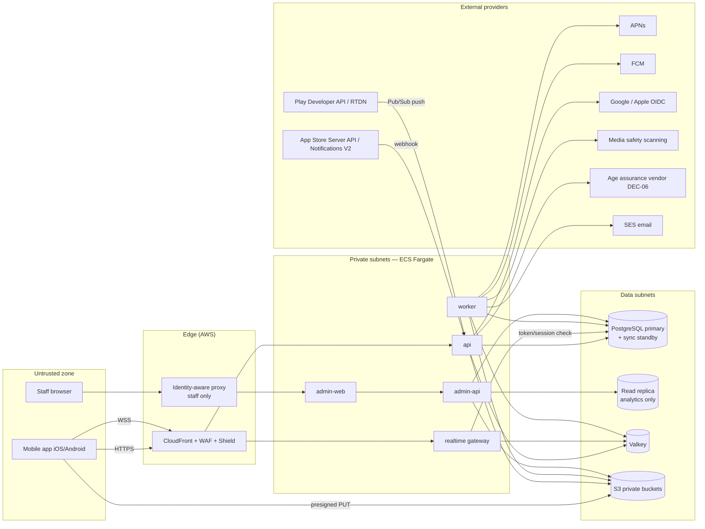

# 05 — System Architecture

**Status:** Proposed · Decisions referenced: ADR-001…018 (doc 04).

## 1. Context and trust boundaries



**Trust boundaries (TB):**
- **TB-1 (mobile ↔ edge):** everything the client sends is untrusted. Strict schemas, authentication, rate limits, and no client-provided entitlement, tier, batch size, cooldown or price.
- **TB-2 (edge ↔ app):** WAF, TLS termination at CloudFront/ALB, mTLS optional. Only the ALB can reach the tasks.
- **TB-3 (app ↔ data):** separate DB roles per deployable (`api_rw`, `worker_rw`, `admin_ro`, `admin_ops`, `breakglass_fn`), least-privilege grants. The anonymity mapping and ledger mutations go only through security-definer functions in sensitive paths.
- **TB-4 (staff plane):** separate identities (SSO + WebAuthn), identity-aware proxy, separate admin-api service, audit on every read of sensitive data.
- **TB-5 (providers):** inbound webhooks are verified (Apple JWS signature chain, Google Pub/Sub OIDC token). Outbound calls carry the minimum data needed.

## 2. Module map (inside the monolith)

| Module | Owns (tables) | Key invariants | Publishes |
|---|---|---|---|
| identity | account, credential, oidc_link, session, refresh_token, consent, age_assurance | unique normalized email/handle; refresh family reuse → revoke | `account.*`, `session.revoked` |
| profile | profile, avatar_version | opaque public ID; gender immutable outside support | `profile.updated` |
| geo | city, district, home_region_history | 30-day interval; Boost lock (with entitlement) | `home_region.changed` |
| social | follow, like, block, block_shield | unique edges; irreversible like; block cascades | `follow.created`, `like.created`, `friendship.formed` |
| conversation | conversation, participant, message, receipt, reveal_event | per-conversation seq; idempotent send; oracle-free CTA rule | `message.committed`, `receipt.updated`, `conversation.revealed` |
| media | media_object, media_unlock, one_view_lease | locked until unlock; single consumption | `media.ready`, `media.unlocked` |
| wallet | wallet, ledger_transaction, ledger_posting, risk_hold, debt | Σ=0; available ≥ 0; idempotent ops | `wallet.credited`, `wallet.debited` |
| billing | store_transaction, subscription_state, store_notification | exactly-once credit per store txn | `purchase.verified`, `subscription.changed` |
| entitlement | plus_entitlement, boost_quote, boost_entitlement, compensation | one active Boost (exclusion constraint); time-based validity | `plus.changed`, `boost.activated` |
| discovery | pool, pool_slot, pool_size, discovery_config_version, aggregate_metric | dense slots; no viewer history | — |
| notification | device_token, notification, notification_pref, push_attempt | dedupe key; privacy-safe copy | — |
| moderation | report, case, action, appeal, media_scan | evidence retention/legal hold | `moderation.action` |
| config | feature_flag, banner_campaign, template, i18n_override | validated bounds; versioned | `config.changed` |
| audit | audit_event (append-only, hash-chained) | immutable | — |

The dependency rule: domain modules depend only on `shared` and on other modules' **public interfaces**, never on their tables. A CI dependency-cruiser rule enforces this.

## 3. Key data flows

### 3.1 Send message (happy path)
```mermaid
sequenceDiagram
  participant A as Sender app
  participant API as api
  participant PG as PostgreSQL
  participant VK as Valkey
  participant RT as realtime
  participant B as Recipient app
  participant WK as worker
  A->>API: POST /v1/conversations/{cid}/messages {client_msg_id, body}
  API->>PG: BEGIN; lock conversation row; seq=last_seq+1; INSERT message ON CONFLICT(client key) DO NOTHING; bump participants' sync_version; INSERT outbox(message.committed); COMMIT
  API-->>A: 201 {message_id, seq, server_ts} (sent)
  API->>VK: PUBLISH u:{B} redacted event (best effort)
  VK->>RT: event
  RT->>B: message.new {cid, seq, ...}
  B->>RT: ack {cid, seq}
  RT->>API: (internal) delivered watermark
  API->>PG: UPDATE participant SET delivered_seq=GREATEST(...)
  WK->>PG: consume outbox: if B has no foreground socket ack within 3s → push job
  WK->>B: APNs/FCM generic notification (dedupe on message_id)
```

### 3.2 Boost activation
`POST /v1/boosts/quotes` → quote row (price snapshot, scope, target, home_region_version, expires 5 min) → user confirms → `POST /v1/boosts/activations {quote_id, idempotency_key}` → single transaction: lock account → lock wallet → verify quote, home version, Plus for CITY, no active Boost → conditional debit → ledger postings → insert ACTIVE entitlement (exclusion constraint) → insert discovery priority-pool slot → outbox → commit. Detail: doc 12 §5.

### 3.3 Shuffle request
`POST /v1/shuffle/sample` → load the immutable config version → resolve the surface from the server-side account state → read-only REPEATABLE READ snapshot → capacity proof per stratum → allocator (pure `shuffle-core`) → priority + discovery draws via dense slots → final authoritative checks (blocks, visibility, time windows) → presentation sort → response with `selection_mode` and `completion`. Nothing is persisted except aggregate counters with no viewer ID. Detail: doc 11.

### 3.4 Store purchase (Gold)
Client purchase → `POST /v1/wallet/purchases/verify {platform, signed transaction}` → server verifies (Apple JWS chain / Google API) → idempotent credit keyed on the store transaction ID → the client finishes/consumes the transaction only after a 200. Server notifications (refund, revoke) run the reversal flow (doc 12 §3).

## 4. Cross-cutting concerns

| Concern | Approach |
|---|---|
| Idempotency | `Idempotency-Key` header on every economic or creating POST. `idempotency_record(account, operation, key, payload_hash, response)` with a 24 h TTL for the generic case; permanent for ledger operations, where the uniqueness lives in domain tables |
| Concurrency | Lock ordering is global and complete (review M2):
  1. `account` (by id asc when two are involved)
  2. `wallet` (by account id asc)
  3. `plus_entitlement` / `boost_quote` / `boost_entitlement` / `media_object` / `media_unlock` / `ledger_account`
  3b. social edges: `block` → `follow` → `profile_counter` (each by account-id pair asc). Mutual-follow reveal and shield lock these before `conversation` (re-review M2)
  4. `conversation`
  5. `participant` (by account id asc)
  6. `user_sync_state` (by account id asc)
  7. `pool_size` / `pool_slot` **last**, by `pool_id` asc

  A lint check in the domain layer asserts the order in every multi-lock function, and deadlock retries are logged as defects. SERIALIZABLE only where needed, with retry (≤ 3, jitter). Elsewhere, row locks plus unique/exclusion constraints |
| Rate limiting | Valkey sliding-window counters per (account, device, IP/ASN, endpoint class). The fallback rule is canonical in doc 10 §6: local strict buckets for everyone; fail-closed for gifts and Boost; fail-closed for search, relationship and Shuffle only for risk-flagged accounts |
| Errors | RFC 9457 problem+json `{type, code, title_key, detail_key, params, request_id}`. Codes are stable enums. Messages are localized on the client |
| Config | Immutable versions. Each request pins one version (A§2). Hot reload via `config.changed` |
| Feature flags | Server-evaluated, audited. Cannot override invariants (A§8.3) |
| Observability | OTel traces across api → PG → outbox → worker → provider. RED metrics per endpoint; business metrics (commit latency, push accept rate, Shuffle underfill rate, ledger reconciliation drift = 0). PII-scrubbed logs: no message bodies, no counterpart IDs in anonymous contexts |
| Secrets | AWS Secrets Manager + KMS. Rotation every 90 days for DB and provider keys. No secrets in images or repo (gitleaks gate) |

## 5. Failure modes (summary; detail in 17 §7)

| Failure | Behavior |
|---|---|
| Valkey down | Messaging commits continue. Realtime fan-out falls back to push + client polling sync (every 15 s while foregrounded). Typing disabled. Rate limits per doc 10 §6. Shuffle correctness is unaffected (no Redis dependency); only risk-flagged accounts are refused |
| Realtime gateway node crash | Clients reconnect with jittered backoff and sync by seq. No loss |
| PG primary failover (Multi-AZ, ~60–120 s) | API returns 503 retryable. Clients keep their offline queue. Wallet ops fail closed. Idempotency keys make retries safe |
| Worker backlog | Push latency degrades. Alerts at lag p95 > 30 s. Outbox persists |
| APNs/FCM outage | Retries with backoff for up to 24 h, TTL-respecting. In-app sync unaffected |
| Store API outage | Purchase verification returns retryable. The client keeps the unfinished transaction and retries. Gold is never credited unverified |
| Media scanner outage | Chat photos stay `PROCESSING` (not delivered) with a retry. Avatars stay on the previous version |
