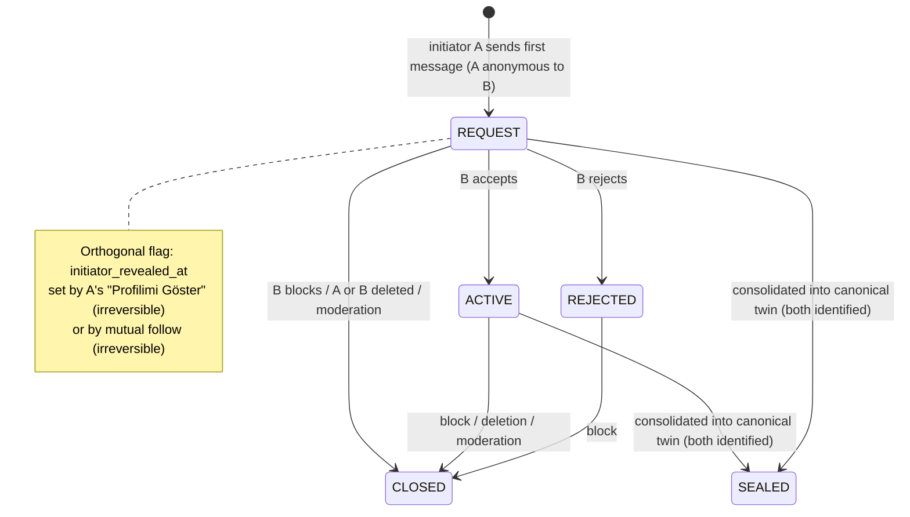

# 08 — Conversations & Real-Time Messaging

Covers REQ-MSG-*, REQ-ANON-02…06 and REQ-MED-04. Proposals that depend on owner decisions are marked **[DEC-xx]**. Until a decision is made, the CONFIRMED spec text governs.

## 1. Principles
1. **PostgreSQL is the record.** A message exists once its commit has assigned a per-conversation `seq`. The socket and push are only *hints* to fetch.
2. **Sends go over HTTP; receipt and typing go over WebSocket.** HTTP gives a clean request/ACK, idempotency keys, rate limiting and auth per send. The socket carries low-latency fan-out and ephemeral signals.
3. **Effects are idempotent everywhere.** Transports may redeliver. Clients dedupe by `(cid, seq)` and server writes dedupe by `client_msg_id`.
4. **Anonymity is resolved only by `counterpartyView`** (ADR-016) for every payload, socket event and push.

## 2. Conversation state machine



**Identity visibility** is a separate, monotonic flag: `ANON → REVEALED` and never back (REQ-SOC-06). B sees A's identity iff `initiator_revealed_at IS NOT NULL`. A always sees B.

**Precedence under concurrent actions** (multi-device races; serialized by the conversation row lock): `moderation > block > delete > reject > accept`. Example: B accepts on phone 1 while blocking on phone 2. The block is applied, and if the accept commits first, the block transitions the conversation to CLOSED afterwards. The final state is deterministic either way.

## 3. Pair model, profile CTA rule and simultaneous starts [DEC-01]

### 3.1 Directional threads
At most one **open** (REQUEST or ACTIVE) thread exists per **ordered** pair `(initiator, recipient)`, enforced by the unique index in doc 06 §4. Terminal threads (REJECTED, CLOSED, SEALED) don't block a restart. So A→B and B→A can coexist, each with its own anonymous initiator.

### 3.2 Profile message action (the oracle-free rule)
For viewer V on profile P, the server computes `actions.message`:
```
if blocked_either_way(V,P) under FULL block visible to V      → UNAVAILABLE
elif ∃ thread T(initiator=V, recipient=P) in REQUEST|ACTIVE     → OPEN_EXISTING(T)   // V started it; V knows P
elif ∃ thread T(initiator=P, recipient=V) in REQUEST|ACTIVE with P revealed → OPEN_EXISTING(T)   // V already knows it's P
elif V is inside a reject cooldown for P (V→P rejected < 30 d)  → UNAVAILABLE        // V knows P; no leak
elif V has a CLOSED/REJECTED thread with P in which V KNOWS P   → START_NEW, with a link to the read-only history on V's side
                                                                  // never offered for a thread where P is anonymous to V (re-review M6)
else                                                           → START_NEW          // creates T(V→P)
```
The rule never consults a thread in which P is still anonymous to V, so V's view of P is **identical** whether or not P has secretly messaged V (verified by the differential tests in doc 10 §5).

### 3.3 Consolidation
When **both** directions involving A and B are identified to each other (each initiator revealed, or a mutual follow reveals both), the newer thread becomes `SEALED` (read-only, linked as "Önceki sohbet") and the older one is canonical. If only one direction exists and it's revealed, rule 3.2 already routes both parties to it, so there's one canonical thread. This keeps "one canonical conversation" (master §5) wherever it's safe.

**Why not a single thread from the start?** If B's "Message" on A's profile landed in A's anonymous thread, B would see "Anonim Kullanıcı" there and learn A's identity, which is exactly the forbidden `Mesaja Git` oracle. This conflict is documented and taken to the owner as DEC-01, as master §5 and §15 instruct.

### 3.4 Request handling [DEC-17]
| Event | Recipient B | Initiator A |
|---|---|---|
| New thread | appears in **Mesaj İstekleri** | thread in A's main inbox, state "İstek gönderildi" |
| B accepts | moves to main inbox | "Kabul edildi" system line. Normal from then on |
| B rejects | removed from requests. Rejection is silent for B | **proposal:** composer disabled, "Bu sohbet artık mesaj kabul etmiyor". A cannot start a new thread to B for 30 days. This tells A nothing about identity, since A already knows B |
| B blocks from thread | thread CLOSED for B and kept read-only/archivable | A sees the same generic "Bu sohbet sona erdi" used for every ending reason [DEC-15] |
| A deletes account | B sees "Sohbet sona erdi". History is kept per retention | — |
| Messages before accept | Unlimited (REQ-MSG-03), with spam/velocity limits per sender (doc 10 §6). Receipts are CONFIRMED as visible to both parties, so they are emitted for requests too, and reading in the request view counts as read | Sees delivered/read |

### 3.5 Reveal flows
- **Self reveal:** A taps `Profilimi Göster` and gets an irreversibility confirmation. `POST /reveal` with a confirmation token sets `initiator_revealed_at` and `reveal_cause='SELF'`, inserts a system message, and sends B an in-app notice plus a generic push.
- **Mutual follow:** inside the follow transaction, if the reverse edge exists, both threads A↔B (any direction with an anonymous initiator) are revealed with `reveal_cause='MUTUAL_FOLLOW'` and the friendship notice goes out. **Disclosure before following** is shown to *everyone* on first follow and in the follow-confirm info sheet. It's generic, so it reveals nothing: "Karşılıklı takipleştiğin kişilerle aranızdaki anonim sohbetlerde kimlikler görünür olur." The **confirmation after mutual** uses the same generic copy for every friendship: "Artık arkadaşsınız. Varsa aranızdaki anonim sohbetlerde kimlikler artık görünür."

## 4. Send path and ordering

1. The client creates `client_msg_id` (UUIDv4), stores the message in its local outbox (`sending`), and renders it optimistically at the bottom.
2. `POST /messages` (HTTP/2 keep-alive). The server, in one transaction:
   - checks authorization (participant, not CLOSED/SEALED/REJECTED for the sender, block, rate limit);
   - inserts into `message_idem_recent` ON CONFLICT → **returns the existing message** (idempotent replay);
   - `UPDATE conversation SET last_seq = last_seq + 1 RETURNING last_seq` (row lock serializes per conversation);
   - inserts the message, bumps `user_sync_state` for both participants (lock in account-id order), upserts their two `conversation_change` rows, and inserts the outbox event. That's about 8–10 row writes per message, which is what doc 17 §5 budgets for.
3. The response `{message_id, seq, server_ts}` puts the message in the **sent** state. The client replaces the optimistic row keyed by `client_msg_id`.
4. After commit the API publishes the per-recipient redacted event to Valkey `u:{recipient}` and the sender's other devices `u:{sender}` (best effort; the outbox retries).

Ordering is by `seq` only. `server_ts` is for display. Client clocks are never used (clock-skew-safe, REQ-MSG-08).

**Retry policy (client):** exponential backoff 0.5 s → 30 s with full jitter, and unlimited retries while the message is < 24 h old. Each attempt reuses the same `client_msg_id`. Non-retryable errors (`ACTION_UNAVAILABLE`, `VALIDATION_FAILED`) mark the message `failed` with a "Tekrar dene / Sil" affordance (local delete only).

## 5. Delivery, receipts, multi-device

| State | Meaning (honest) | Trigger |
|---|---|---|
| sending | local only | user taps send |
| sent | durably committed on the server | HTTP 201 |
| delivered | **at least one recipient device persisted it** | recipient device `ack {cid, seq}` (socket) or `POST /receipts` after a sync fetch |
| read | recipient viewed the conversation with the message on screen, app foregrounded | client `read_seq` update |

- Watermarks are **monotonic**: `delivered_seq = GREATEST(delivered_seq, :x)` and `read_seq = GREATEST(read_seq, :x)`, with `read ⇒ delivered`. Updates emit `receipt.updated` to the counterpart and to the user's own other devices (multi-device read sync).
- Push acceptance by APNs or FCM does **not** set delivered (REQ-MSG-13). On iOS a background push usually can't run code reliably, so "delivered" may only advance when the app next syncs. This is documented in the UI semantics.
- Multi-device: every device of a user holds its own socket. All devices receive events. Unread counts come from the server's `read_seq`.

## 6. Realtime protocol (AsyncAPI 3.0 source at M1)

Connection: `wss://rt.flero.app/v1?` with no token in the URL. The first frame is `{"t":"auth","token":"<access JWT>"}` within 5 s, or the server closes. The server re-checks session revocation every 60 s and on the `session.revoked` channel.

| Direction | Event | Payload (abridged) |
|---|---|---|
| S→C | `hello` | `{v:1, heartbeat_s:25, sync_version}` |
| S→C | `message.new` | `{event_id, cid, seq, message_id, kind, body?, media?: {mid, locked:true}, server_ts, sync_version}` |
| S→C | `message.committed` | own message from another device |
| S→C | `receipt.updated` | `{cid, delivered_seq, read_seq}` |
| S→C | `conversation.updated` | `{cid, state, revealed?, counterparty?(projection)}` |
| S→C | `typing` | `{cid, state: on|off}` (TTL 5 s) |
| S→C | `sync.hint` | `{sync_version}` (client must call `/v1/sync` if it detects a gap) |
| S→C | `session.revoked` | then close 4001 |
| C→S | `ack` | `{cid, seq}` (delivered) |
| C→S | `typing` | `{cid, state}` (≤ 1 per 3 s per conversation; dropped if the conversation is not ACTIVE/REQUEST for the sender) |
| both | `ping`/`pong` | keepalive 25 s. **`pong` carries the current `sync_version`**, so a lost trailing event is detected within one heartbeat, not only on reconnect (review M4) |
| C→S | `reauth` | `{token}`: a fresh access JWT sent before the current one expires. If not received within 60 s after expiry, the server closes with 4002 and the client reconnects |

**Gap detection and resume:** each event carries the user's `sync_version`. If the client sees `sync_version > local + 1`, or it reconnects, it calls `GET /v1/sync?since_version=local`. That returns changed conversations, after which the client pulls `messages?after_seq=` per conversation. `conversation_change` keeps one upserted row per (account, conversation), so the feed never loses changes. The server returns `full_resync_required` only when the client is missing `since_version` or reports one ahead of the server (reinstall, restored backup). In that case the client re-pages the inbox.

**Typing:** client heartbeat every 3 s while composing; stop on blur, send, app background, or 5 s idle. The server relays via Valkey and never persists or pushes typing (REQ-MSG-10, REQ-NTF-02).

**Presence [DEC-14 proposal]:** internal presence (socket routing keys in Valkey, TTL 60 s) is used only to decide push versus no push. **No user-visible online or last-seen status** on profiles, cards, search or anonymous threads. In identified, ACTIVE conversations, optional "aktif" status could be enabled later behind a user setting. It's off by default and out of v1 scope.

## 7. Offline behavior (mobile)
- Local store: encrypted SQLite (op-sqlite + SQLCipher; the key lives in the Keychain/Keystore) holding the conversation list, the most recent 200 messages per conversation, and the outbox.
- Offline: read cached content, compose (queued), and see "Çevrimdışısın". Gold, unlock and reveal actions are disabled while offline (they need the server).
- Retention: the client purges locally on the same schedule as the server (text older than 12 months, media references older than 90 days) and on the server's `retention.purged` sync flags.

## 8. Media in chat (flow; economics in doc 12)
1. Sender picks a photo and the client prepares it (HEIC→JPEG/HEIF, max 2048 px, EXIF orientation applied).
2. `POST /media/uploads` returns a presigned PUT into `quarantine/`.
3. Upload. `complete` sets state PROCESSING. The worker strips metadata and re-encodes (AVIF+JPEG, max 1600 px), runs CSAM hash match + nudity/violence classifiers (DEC-13), and sets READY or REJECTED. `unlock_price_gold` is snapshotted.
4. On READY, a PHOTO message commits (seq assigned). The recipient sees a **locked tile with no derived pixels** (design 14 §6). The sender sees their own photo for free.
5. **One-view open protocol [DEC-25]:** `POST /open` (requires UNOPENED, open_attempts < 3) creates a lease (90 s) and a single-use proxied URL served by the media service, never the CDN. The client downloads to memory, renders, then calls `POST /rendered {lease_id}` and the state becomes CONSUMED. If the lease expires without `rendered`:
   - Bytes not fully delivered → back to UNOPENED, `open_attempts++` (reconnect grace).
   - Bytes fully delivered but no render ack → **one** grace re-open is allowed within 10 minutes. After that, or if the grace re-open also ends without an ack, the item is CONSUMED.

   Master §6 forbids "accidental consumption before successful render", but a client that withholds the ack could replay forever. This bounded grace is the proposed balance (review H4). The owner decides it as DEC-25. The image is never written to disk cache (`cachePolicy: none`) and FLAG_SECURE / iOS capture protection is applied best effort (REQ-MED-08).

## 9. SLO targets (to be measured; doc 17)
| Metric | Target | Conditions |
|---|---|---|
| Send commit latency (server) | p50 ≤ 40 ms, p95 ≤ 150 ms, p99 ≤ 400 ms | design-peak load (doc 17 §3) |
| End-to-end online delivery (commit → recipient socket) | p95 ≤ 500 ms, p99 ≤ 1.5 s | both parties foregrounded, EU/TR networks |
| Commit availability | 99.95 % monthly | excluding client network |
| Reconnect-to-synced | p95 ≤ 2 s for ≤ 50 changed conversations | |
| Message loss | 0 committed messages lost on AZ failure (sync standby, RPO 0). Region-loss DR: RPO ≤ 15 min (doc 16 §7) | |

## 10. Required tests (summary; doc 18)
**Implemented at M1 (2026-11-14):** `packages/conversation-model` is an executable reference model of the rules in §2–§3 and doc 10 §3.1, with:
- a random-interleaving invariant test
- a differential suite for the hidden anonymous thread (O1/O2/O10)
- a shield-scope differential test (C2a/O21)
- scenario tests for DEC-01, DEC-02 and DEC-17

Each differential test was mutation-checked: re-introducing the `Mesaja Git` leak or an over-broad shield makes it fail. The backend's integration tests must replay the same action sequences against the real API (M3.3).

- State machine model test: random interleavings of send, accept, reject, block, reveal, follow/unfollow, delete across 2 users × 2 devices. Invariants: no state regressions, reveal monotonic, CTA rule oracle-free, at most one non-sealed thread per ordered pair.
- Failure injection (Toxiproxy): drop or duplicate ack frames, kill the gateway mid-stream, fail PG over during a send → no duplicates, no loss, monotonic watermarks.
- Clock-skew test: device clocks ±1 day → ordering unchanged.
