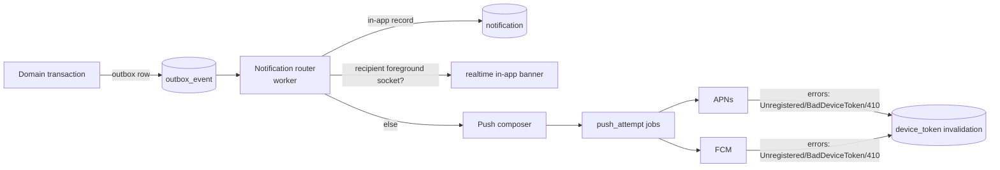

# 09 — Notification Architecture

Covers REQ-NTF-01…05 and REQ-SOC-02. **Platform truth:** APNs and FCM are best-effort services. Acceptance by them is not delivery; iOS throttles background pushes, Android OEM battery managers kill apps, and users disable permissions. FLERO promises neither delivery nor timing (REQ-OPS-04). It measures what it can.

## 1. Pipeline

1. **Event → decision.** The router loads recipient preferences (topic toggles, quiet hours in the user's time zone, mute per conversation), the dedupe key, and **presence** (does a foreground socket exist for a session that acked within 30 s?).
2. **In-app.** A `notification` row is always written for the notification-center classes (follow, like, friendship, reveal, unlock, gift, lifecycle, wallet, security, moderation). Chat messages don't create notification-center rows; the inbox covers them.
3. **Push.** Sent when no foreground socket is present, or for security-class events regardless of presence. Collapse and thread IDs are per conversation public ID (`apns-collapse-id`, FCM `collapse_key` / `tag`).
4. **Dedupe.** Key `(recipient, event_type, domain_id)` with a unique index on `push_attempt`, so a retried or replayed outbox event never sends twice. Message bursts coalesce: at most 1 push per conversation per 10 s, with the counter carried in the payload ("3 yeni mesaj").
5. **Retry.** Provider 5xx, 429 or timeout → exponential backoff (5 s … 30 min), giving up at the message TTL (chat: 6 h; social: 24 h; security: 72 h). Token-invalid responses mark the token invalidated immediately.

## 2. Device token lifecycle
- On launch and on token change, the app calls `PUT /v1/me/devices/{installation_id}/push-token`. The row is bound to the **session**, so revoking the session invalidates its tokens (no pushes to a signed-out device).
- Tokens are stored hashed + encrypted (KMS envelope); only the worker role can decrypt.
- Staleness: tokens not refreshed in 60 days are pruned. Provider invalidation is honored immediately. A user with more than 10 tokens has the oldest evicted.
- Logout deletes the token row before the session is revoked.

## 3. Permission education
- No OS prompt at first launch. A pre-prompt explains the value and the privacy-safe copy ("Kilit ekranında kimlikler gizli kalır"). The OS prompt comes after the first meaningful moment (first message sent or received), or from settings.
- Android 13+ `POST_NOTIFICATIONS` runtime permission. iOS provisional authorization is **not** used, since quiet delivery would undercut message semantics.
- A permission-denied state is visible in settings, with a deep link to system settings.

## 4. Privacy-safe copy (REQ-NTF-04, threat model oracle #13)

| Event | Lock-screen default (tr) | Never includes |
|---|---|---|
| New message, anonymous thread | "Anonim Kullanıcı: Yeni mesaj" | sender name, avatar, gender, body |
| New message, identified | "{display_name}: Yeni mesaj" (body preview **off by default**, opt-in "Mesaj önizlemesi") | photo content |
| New request | "Yeni bir mesaj isteğin var" | sender |
| Photo received | "Yeni bir fotoğraf aldın" | thumbnail (no rich media attachment) |
| Unlock of your photo | "Fotoğrafın açıldı" | who (in anonymous threads) |
| 1-Gold gift | "1 Gold aldın" | counterpart in anonymous threads ("Anonim Kullanıcı") |
| Follow | "Bir kişi seni takip etti" | follower |
| Like | "Biri profilini beğendi" | liker |
| Friendship / reveal | "Yeni bir arkadaşlık" / "Bir sohbette kimlik görünür oldu" | (details in-app after auth) |
| Plus/Boost/wallet/security/moderation | functional text | amounts beyond the user's own |

- No iOS Communication Notifications (`INSendMessageIntent`) and no Siri/Spotlight donations. No Android `Person`, conversation shortcuts or bubbles for anonymous threads. Identified threads may later use them behind a setting (out of v1 scope).
- Notification grouping (`thread-id`, Android group) uses conversation IDs and the push category only. Follow/like notifications are **never grouped with message notifications**, which would correlate their timing.
- **[DEC-16] Timing correlation:** anonymous follow/like notifications get a random 0–15 min dispatch jitter by default, which weakens "follow arrives the same second as an anonymous message" correlation. The default without approval is near-real-time with jitter off, because the spec says "near-real-time".

## 5. Deep links
`flero://c/{cid}`, `flero://n/{notification_id}`, `flero://wallet`, `flero://boost`. Links carry only opaque IDs. After authentication the app calls the API, which re-authorizes. An anonymous thread link can never route to a profile. Universal Links / App Links are verified domains.

## 6. Background and terminated apps
- iOS: alert pushes (`apns-push-type: alert`, priority 10 for chat, 5 for social). A Notification Service Extension is **not** required in v1, since generic copy needs no decryption or fetch. Data-only background pushes are used just to hint a sync, without relying on them.
- Android: FCM high-priority only for chat and security (to stay within FCM's quota for high priority). `notification` + `data` messages; channels: `chat`, `requests`, `social`, `wallet`, `account`, `marketing` (off by default, separate consent).
- Test matrix (doc 18): foreground, background, terminated (swiped away), Doze, low-power mode, permission revoked, token rotated, multiple devices. iOS 17+ / Android 10+ across 6+ OEMs, including Xiaomi, Samsung, Huawei (no GMS; FCM unavailable, so in-app only, a documented limitation).

## 7. Preferences
Topics: messages, requests, social (follow/like/friend), gifts & unlocks, Plus/Boost, wallet, marketing (opt-in, separate consent). Security and moderation can't be disabled. Quiet hours (default off; window in the user's local time zone) suppress non-security pushes; the in-app record is still written. Per-conversation mute.

## 8. Observability and diagnostics
- Metrics per provider and platform: attempts, accepted, rejected-by-reason, invalid tokens, latency (commit → provider accept), coalescing rate.
- **Open rate** comes from notification taps (client event with notification_id). It's aggregated with no message content.
- Admin "push diagnostics" for a user (support role, with the user's consent ticket): last 20 attempts with provider status codes. No payload text for anonymous threads.
- Alerts: provider error rate > 5 % for 10 min; invalid-token spike; worker lag p95 > 30 s.

## 9. Capacity (base case, doc 17)
~4M pushes/day at 1M registered (≈ 46/s average, ≈ 250/s evening peak). APNs/FCM HTTP/2 connection pools of 4–8 connections per worker. Throughput headroom > 10×.
