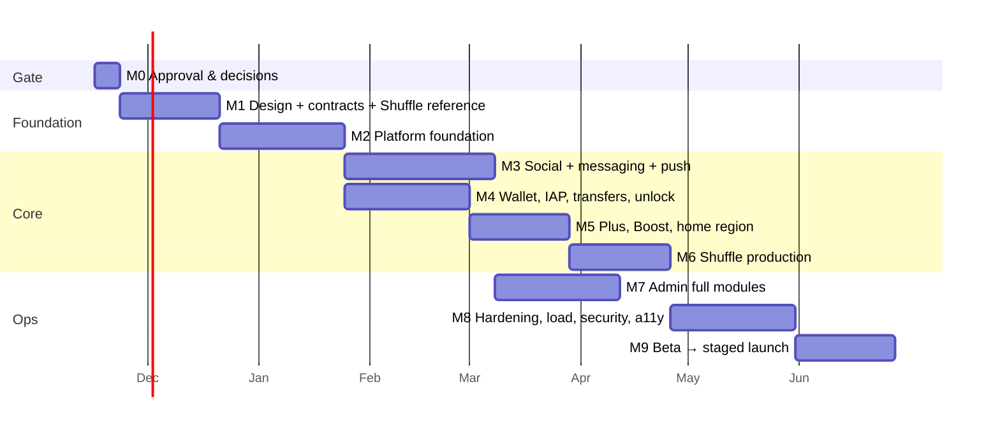

# 19 — Implementation Roadmap

The roadmap follows the master §14 stages, adjusted for dependencies. Durations are **estimates** for a team of 4–6 engineers plus one designer, assisted by agents. They are not commitments. Each milestone ends with a demo and evidence review. Nothing in this roadmap starts until the architecture is approved (M0).

## Milestone overview

**Critical path:** M0 → M1 → M2 → M4 → M5 → M6 → M8 → M9. M3 and M4 run in **parallel** after M2, since they touch separate modules. M7 can start after M3, and its finance and config parts integrate with M4–M6 as they land.

---

## M0 — Approval gate (this document set)
- **Deliverables:** owner decisions on the DEC list (doc 00 §7), ADRs accepted, budget approved.
- **Definition of done:** a signed decision log entry for every blocking DEC.

## M1 — Design system, contracts, Shuffle reference (Stage 1)
| Task | Owner (agent) | Depends | Done when |
|---|---|---|---|
| M1.1 Screen inventory + navigation graph + state matrices for every screen (doc 14 §11) | design-director | M0 | reviewed doc + flow diagrams for 100 % of the screens in master §3 |
| M1.2 Tokens package (`ui-tokens`) + measured contrast report + Turkish glyph test | design-director + frontend-mobile-engineer | M1.1 | contrast report ≥ AA for every token pair; glyph screenshots |
| M1.3 Coded prototypes: 4 Shuffle card variants, list, filter sheet, locked photo tile, unlock/gift sheets, paywall, Boost checkout | frontend-mobile-engineer + motion-specialist | M1.2 | golden screenshots (light/dark/200 %); **frame-time gate on a midrange Android: ≤ 1 % frames > 16.7 ms while scrolling 500 cards** (ADR-002 go/no-go) |
| M1.4 OpenAPI v0 + AsyncAPI v0 for all v1 resources, with forbidden-field annotations | backend-database-engineer | M0 | spec lint green; examples validate; owner-reviewable |
| M1.5 DB ERD + migration v0 (not applied to prod) | backend-database-engineer | M1.4 | schema reviewed by ecc:database-reviewer |
| M1.6 Conversation state machine spec + model-test harness skeleton | backend-database-engineer | M0 (DEC-01, DEC-02) | doc + executable model with invariants |
| M1.7 `tools/shuffle-reference` (productionized spike) + `shuffle-core` allocator (TS) with cross-agreement tests | backend-database-engineer | M0 | G2 partial: enumerator and agreement green in CI |
| M1.8 Threat model sign-off (doc 10) | ecc:security-reviewer | M1.4, M1.6 | no open critical items without a decision |

## M2 — Platform foundation (Stage 2)
| Task | Depends | Done when |
|---|---|---|
| M2.1 Monorepo, CI (doc 16 §4), dependency rules, Renovate | M1 | PR pipeline green on a skeleton |
| M2.2 OpenTofu: dev and staging accounts, network, RDS, ElastiCache, S3, CDN, WAF, observability | M2.1 | `tofu apply` staging; smoke reachable; **owner approval for cloud spend** |
| M2.3 Identity: signup/login (email, Google, Apple), sessions, refresh rotation, reset, email verify, provider linking, sign-out-all | M2.1 | integration + security tests (token reuse, linking takeover attempts); security review |
| M2.4 Age assurance (per DEC-06) + consents (versioned) | M2.3 | consent records verified; underage paths blocked |
| M2.5 Geo catalog + home region (first selection, 30-day rule, history) | M2.3 | T33, T34, T49 green |
| M2.6 Profile + avatar pipeline (editor, upload resume, server re-encode, moderation hook) | M2.3 | crop pixel tests; weak-network E2E; EXIF golden |
| M2.7 Admin shell: staff SSO + WebAuthn, RBAC, audit log (hash chain + Object Lock export) | M2.2 | Playwright RBAC tests; audit verification |
| M2.8 Observability baseline: OTel, dashboards, SLO alerts, Sentry (scrubbed) | M2.2 | traces visible end-to-end on staging |
| M2.9 Mobile app shell: boot gate, tabs, i18n tr/en, theming, secure storage | M1.3 | Maestro onboarding flow green on iOS and Android |

## M3 — Social graph, conversations, realtime, push, safety (Stage 3)
| Task | Depends | Done when |
|---|---|---|
| M3.1 Follow, like, block (FULL + shield per DEC-02), counters, friendship (owner-only) | M2 | concurrency tests; contract privacy tests |
| M3.2 Search (prefix, throttled, block-aware) + rate limiter with fallback | M3.1 | scraping test (T27-like) and the Valkey-down test |
| M3.3 Conversations: directional threads, CTA rule, requests, accept/reject, reveal, mutual-follow reveal, consolidation | M1.6, M3.1 | model test 10k interleavings green; differential oracle suite O1–O5, O10–O12 green |
| M3.4 Messages: send/seq/idempotency, sync API, receipts, retention partitions | M3.3 | fault-injection: no loss or duplicate; watermarks monotonic; **early k6 commit benchmark on a prod-class DB** (doc 21 note 1: the tightest capacity margin) |
| M3.5 Realtime gateway + Valkey fan-out + typing | M3.4 | k6 WS soak 10k sockets on staging; reconnect storm test |
| M3.6 Mobile: inbox, requests, conversation, offline queue, encrypted cache | M3.4, M3.5 | Maestro chat flows incl. airplane-mode toggles |
| M3.7 Notifications: router, APNs/FCM, tokens, preferences, quiet hours, privacy copy | M3.4 | background/terminated matrix on devices; payload fuzz green |
| M3.8 Reports, moderation queue, media scanning integration (DEC-13), CSAM procedure | M3.3 | E2E report-from-anonymous-thread; scanner-outage behavior |

## M4 — Wallet, Gold purchase, transfers, media unlock (Stage 4a)
| Task | Depends | Done when |
|---|---|---|
| M4.1 Ledger schema, `wallet_apply`, reconciliation job + alert | M2 | conservation property tests; drift-injection drill |
| M4.2 Store Gold top-ups (Apple + Google), verification, notifications, refunds and chargebacks (debt) | M4.1 | sandbox matrix; duplicate notifications idempotent |
| M4.3 1-Gold gift (separate confirm, velocity, fail closed) | M4.1, M3.3 | 100-parallel test; anonymous history rendering test |
| M4.4 Chat media: upload, processing, locked tile, unlock (persistent/one-view), open/rendered protocol, moderation refund | M4.1, M3.4 | one-view replay test; sender-free test; idempotent unlock |
| M4.5 Wallet UI: balance, store, history, insufficient-Gold flows | M4.2 | Maestro purchase flow (sandbox) |

## M5 — Plus, Boost, home-region lock (Stage 4b)
| Task | Depends | Done when |
|---|---|---|
| M5.1 Plus subscription lifecycle (both stores), entitlement, bonus Gold, paywall | M4.2 | sandbox renew/grace/expire/refund; REQ-PLS-05 tests |
| M5.2 Boost catalog, quotes, activation transaction, status, disclosure | M4.1, M2.5 | T50–T57, T94–T95 green under concurrency |
| M5.3 Region change ⟂ Boost lock | M5.2 | T21, T35, T36 green |
| M5.4 Outage telemetry + compensation review workflow | M5.2, M2.8 | T98 green with synthetic incidents |

## M6 — Shuffle production (Stage 4c)
| Task | Depends | Done when |
|---|---|---|
| M6.1 Discovery directories, transactional maintenance hooks in every membership event | M2.5, M5.1, M5.2 | invariant check job: directory equals the authoritative query (nightly, 0 diffs) |
| M6.2 Sampler + capacity proof + post-check + responses | M1.7, M6.1 | all T01–T101 mapped suites green |
| M6.3 Statistical gate vs reference | M6.2 | G2 report artifact |
| M6.4 Mobile Shuffle list, filters, paywall locks, states | M6.2, M1.3 | golden snapshots T79; T29/T30 E2E |
| M6.5 Aggregate metrics (no viewer IDs, k-threshold) | M6.2 | privacy test T101 |

## M7 — Admin platform full modules (Stage 5a)
Users, reports and appeals, break-glass investigations, media moderation, catalogs, Gold and risk, Boost operations, Shuffle config with simulation and staged rollout, banners, templates, flags, ops health, reconciliation, privacy requests. **Done when:** a Playwright suite covers each module's happy path and RBAC denials; maker-checker is enforced; T26, T38, T80 and T101 are green.

## M8 — Hardening (Stage 5b)
Load tests (doc 17 §8), fault injection, DR drill, external pentest, accessibility audit, device matrix, frame-time and startup measurements, legal and store review package, published policies. **Done when:** gates G1–G11 pass, or the owner signs an explicit risk acceptance for each failure.

## M9 — Beta and staged launch (Stage 5c)
Closed beta (TestFlight / Play closed testing, Turkey only, invite-based, 1–5k users) → open beta → staged production rollout. Daily review of SLOs, ledger reconciliation, moderation SLAs and crash-free rate. **Done when:** owner sign-off (G12) and store approval. Store approval cannot be guaranteed (RISK-01).

## Parallel lanes and ownership boundaries
| Lane | Modules/files | Can run in parallel with |
|---|---|---|
| L-Design | `packages/ui-tokens`, design docs, prototypes | everything |
| L-Identity | `domain-identity`, `domain-profile`, `domain-geo` | L-Admin shell |
| L-Social/Chat | `domain-social`, `domain-conversation`, `apps/realtime` | L-Wallet (after M2) |
| L-Wallet | `domain-wallet`, `domain-billing`, `domain-media` (unlock part) | L-Social/Chat |
| L-Entitlement/Shuffle | `domain-entitlement`, `domain-discovery`, `shuffle-core`, `tools/shuffle-reference` | L-Admin (config UI after M6.2) |
| L-Admin | `apps/admin`, `apps/admin-api` | most lanes once domain commands exist |
| L-Infra | `infra/`, CI | everything |
**Sequential constraints:** the ledger (M4.1) precedes unlock, gift, Boost and Plus bonus. Directories (M6.1) need the membership events from M2.5, M5.1 and M5.2. The CTA rule (M3.3) needs DEC-01. The shield block needs DEC-02.
