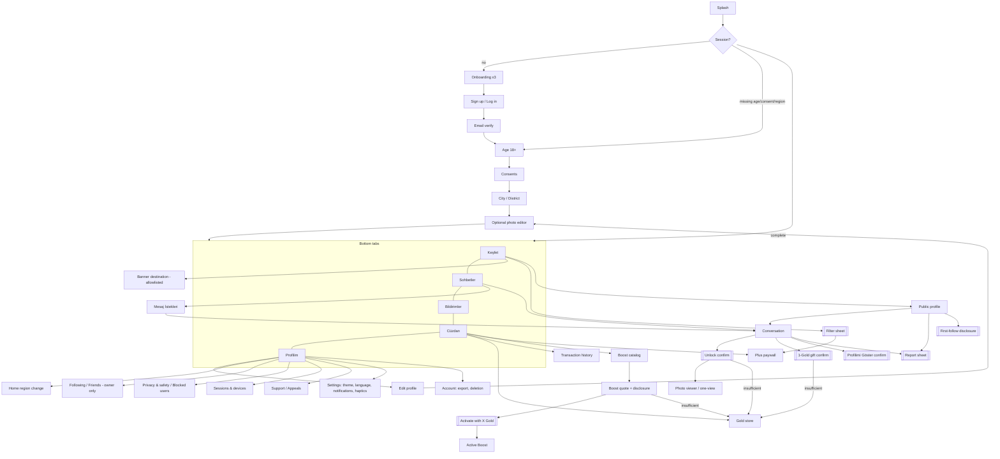

# FLERO — Screen Inventory & Navigation (M1.1)

**Source:** master §3 screen list, Appendix A §7, docs 08/12/13/14. Visual direction: doc 14 ("Fener Işığı"), tokens in `packages/ui-tokens`.
**Status:** v1 inventory for review. M1.3 prototypes and golden screenshots (light, dark, 200 % text) are produced **per row** below.

## 1. Navigation graph

`[[…]]` = modal or sheet. Deep links (doc 09 §5) enter after the boot gate. Unauthorized targets land on the neutral "Bu içerik kullanılamıyor".

## 2. Variant axes used below
- **Tier:** `STD` (Standard), `PLUS`, and `PLUS→STD` (expired Plus that still holds a city Boost).
- **Boost:** `NB` (no Boost), `BD` (district Boost active), `BC` (city Boost active).
- **Role in a thread:** `INIT` (initiator: always knows the counterpart), `RCPT-ANON` (recipient, initiator hidden), `RCPT-ID` (recipient, initiator revealed or mutual).
- **Standard states** (rules/ui-ux.md): `loading` · `empty` · `error` · `offline` · `disabled` · `success`. Extra states are listed per screen.

## 3. Inventory

| ID | Screen | Route | Variants | States beyond standard | Critical rules (REQ) |
|---|---|---|---|---|---|
| S01 | Splash | `(boot)/index` | — | slow-network fallback after 3 s | no data before auth |
| S02 | Onboarding (3) | `(boot)/onboarding` | tr / en | skip | honest positioning: moderated social network (RISK-01) |
| S03 | Sign up / Log in | `(boot)/auth` | email · Google · Apple | provider error, account exists (no enumeration copy) | REQ-ONB-01, ID-03 |
| S04 | Email verify | `(boot)/verify` | — | code expired, resend cooldown | REQ-ID-03 |
| S05 | Age 18+ | `(boot)/age` | self-declared · vendor escalation | underage → blocked end state | REQ-ONB-03, DEC-06; DOB never stored |
| S06 | Consents | `(boot)/consent` | marketing opt-in separate | version changed → re-consent | REQ-ONB-04 |
| S07 | City / District | `(boot)/region` | first selection | "starts the 30-day clock" note | REQ-ONB-06, REG-01 |
| S08 | Photo editor | `(modals)/photo-editor` | camera · library · limited library | permission denied, HEIC converting, upload progress / retry / cancel / resume, moderation pending, rejected | REQ-AVA-01…05 |
| S09 | Keşfet: banners + Shuffle | `(tabs)/kesfet` | STD / PLUS / PLUS→STD × NB/BD/BC (owner's own view) | skeleton (8 rows), `EXHAUSTED` footer, `UNCERTAIN` retry footer, zero-EXHAUSTED empty, zero-UNCERTAIN transient | A§7.1, T16–T19, T29–T30; 4 card variants (S09a–d) |
| S09a–d | Shuffle card variants | component | STD-DISC · PLUS-DISC · STD-BOOST · PLUS-BOOST (+ Boost holder in DISCOVERY = a or b) | pressed, focused, 200 % text | badge only when placement is BOOST_BLOCK; one badge slot |
| S10 | Filter sheet | `(modals)/filter` | STD: district locked, Kadın/Erkek locked · PLUS: district/city + gender | locked-tap → paywall; Plus expiry resets the filter | REQ-SHF-03, PLS-05 |
| S11 | Public profile | `(tabs)/kesfet/profile/[id]` | message CTA: OPEN_EXISTING / START_NEW / UNAVAILABLE · follows_me · liked (irreversible) · friend | profile unavailable (generic) | REQ-ANON-03 (CTA rule, doc 08 §3.2), SOC-04/07 |
| S12 | First-follow disclosure | `(modals)/follow-info` | — | — | REQ-SOC-06 generic copy, shown to everyone |
| S13 | Inbox | `(tabs)/sohbetler` | main · requests · archived | muted, unread, search-no-results | REQ-MSG-06; anonymous rows show only "Anonim Kullanıcı" |
| S14 | Mesaj İstekleri | `(tabs)/sohbetler/requests` | — | filtered-spam subfolder | REQ-MSG-02 |
| S15 | Conversation | `(tabs)/sohbetler/[cid]` | INIT / RCPT-ANON / RCPT-ID × REQUEST / ACTIVE / REJECTED / CLOSED / SEALED | sending / sent / delivered / read, failed (retry or delete locally), typing, offline queue, "Sohbet sona erdi", "Bu sohbet artık mesaj kabul etmiyor", "Önceki sohbet" link | REQ-MSG-*, DEC-01/02/15/17, doc 10 §3.2 delayed closure |
| S16 | Locked photo tile | component | sender (free view) · recipient locked · unlocked · one-view unopened / consumed · expired · removed | failed-render grace (DEC-25) | REQ-MED-01…06; no pixels from the image |
| S17 | Unlock confirm | `(modals)/unlock` | persistent · one-view | insufficient Gold → store; expiry date shown | REQ-MED-03, DEC-05 |
| S18 | Photo viewer | `(modals)/viewer/[mid]` | persistent · one-view | screenshot best-effort notice, lease expired | REQ-MED-04/08 |
| S19 | 1-Gold gift confirm | `(modals)/gift` | — | insufficient, rate-limited (generic), restricted | REQ-GLD-05; no quantity control |
| S20 | Reveal confirm | `(modals)/reveal` | — | irreversible confirmation | REQ-MSG-01 |
| S21 | Report sheet | `(modals)/report` | profile · conversation · message · media | submitted (generic outcome later, DEC-18) | REQ-ANON-05, MED-06 |
| S22 | Notifications | `(tabs)/bildirimler` | per class (doc 09 §4) | permission-off banner | REQ-NTF-01/04 |
| S23 | Wallet | `(tabs)/cuzdan` | normal · restricted (debt / hold) | — | REQ-GLD-01/07; no other users' amounts |
| S24 | Gold store | `(tabs)/cuzdan/store` | iOS · Android | verifying…, pending store, failed, restored | REQ-GLD-04; client never credits |
| S25 | Transaction history | `(tabs)/cuzdan/history` | gift (anonymous label), unlock, Boost, bonus, reversal | — | REQ-GLD-08 |
| S26 | Plus paywall | `(tabs)/cuzdan/plus` | monthly · yearly · active · grace | restore, store error | REQ-PLS-03: honest benefits incl. rank advantage |
| S27 | Boost catalog | `(tabs)/cuzdan/boost` | STD (district only) · PLUS (district + city) · active (no purchase) | disabled while active | REQ-BST-02/03 |
| S28 | Boost quote + confirm | `(tabs)/cuzdan/boost/quote` | district · city | quote expired, stale region, insufficient, "İşlem kontrol ediliyor" | REQ-BST-04/08; disclosure must render before confirm |
| S29 | Active Boost status | `(tabs)/cuzdan/boost/active` | district · city · Plus expired with city Boost | hidden-profile warning (time continues) | A§8.8 no-pause |
| S30 | Own profile | `(tabs)/profilim` | STD / PLUS | — | own friend count visible only here |
| S31 | Edit profile | `(tabs)/profilim/edit` | — | validation | gender not editable (support only) |
| S32 | Home region change | `(tabs)/profilim/home-region` | allowed · TOO_SOON {date} · LOCKED_BY_BOOST {date} | same-region no-op | REQ-REG-01/02 |
| S33 | Following / Friends | `(tabs)/profilim/following` | following · friends (owner only) | empty | REQ-SOC-03/05 |
| S34 | Privacy & safety / Blocked | `(tabs)/profilim/privacy` | blocked list (FULL only; shields are never listed with identity) | unblock confirm (no auto-restore) | REQ-SOC-08 |
| S35 | Sessions & devices | `(tabs)/profilim/sessions` | — | sign-out-all (step-up) | REQ-ID-04 |
| S36 | Support / Appeals | `(tabs)/profilim/support` | ticket · appeal | — | master §3 |
| S37 | Settings | `(tabs)/profilim/settings` | theme · language · notification topics · quiet hours · haptics · message preview | — | REQ-NTF-03 |
| S38 | Account: export / deletion | `(tabs)/profilim/account` | export requested / ready · deletion scheduled / cancel | step-up | REQ-ID-07 |
| S39 | Generic unavailable / error | shared | with request ID | — | doc 14 §10 |

Admin web screens are inventoried separately (doc 15 §3 module list). Its inventory follows in M7.

## 4. Per-screen acceptance checks (template, applied to every row)
1. **Golden screenshots:** light, dark and 200 % text for every listed variant and state.
2. **Accessibility:** one accessible element per card; labels per doc 14 §5; focus returns to the origin; live regions for UNCERTAIN, offline and unlock results.
3. **Anonymity:** for S09, S11, S13, S15, S19, S22 and S25, the rendered strings contain no counterpart identity in RCPT-ANON contexts. This is checked against the conversation-model fixtures.
4. **Copy:** all strings come from i18n keys (tr + en), and errors render from stable codes.
5. **Motion:** only doc 14 §8 allowed motions; Reduced Motion variant captured.

## 5. Open items
- DEC-22 (optional "Öne Çıkan ⓘ" caption on S09).
- Exact copy for S02 onboarding positioning (RISK-01, DEC-21), which needs counsel input.
- Frame-time gate on S09 needs the Expo prototype and a midrange Android device (M1.3).
